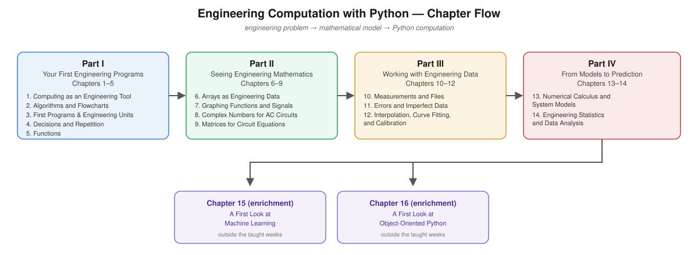

# Engineering Computation with Python

Beamer slide decks (16 chapters) and the complete code listings for my book *Engineering Computation with Python: An Introduction for Electrical Engineering Students*.

## About the book

This book introduces Python as an engineering tool for students who may never have written a program before. Its purpose isn't to turn you into a software developer — it's to teach you how to take an engineering problem, express it mathematically, translate that mathematics into Python, run the calculation, visualize the result, and decide whether the result makes engineering sense.

The chapters follow a repeating pattern: **engineering problem → mathematical model → Python computation.** A variable becomes an array; an array becomes a signal; a signal can be plotted, analyzed, differentiated, and integrated; measurements can be fitted to a model, and that model used for prediction. Throughout, the same progression applies: **understand → calculate → visualize → experiment → interpret.**

Examples are drawn from electrical engineering — voltage, current, resistance, capacitance, frequency, sensor measurements, and system responses — so that mathematical ideas (complex numbers, matrices, derivatives, integrals, regression, statistics) are always introduced alongside the computation that makes them concrete.

## Chapter flow

The second edition (J2) of the book has 16 chapters: four parts, one chapter per teaching week, followed by two non-week enrichment chapters. The slide decks follow the same numbering.



- **Part I — Your First Engineering Programs** (Ch 1–5): computing as an engineering tool, algorithms and flowcharts, first programs, engineering units, decisions and repetition, and functions.
- **Part II — Seeing Engineering Mathematics** (Ch 6–9): arrays as engineering data, graphing functions and signals, complex numbers for AC circuits, and matrices for circuit equations.
- **Part III — Working with Engineering Data** (Ch 10–12): measurements and files, errors and imperfect data, and interpolation, curve fitting and calibration.
- **Part IV — From Models to Prediction** (Ch 13–14): numerical calculus and system models, then engineering statistics and data analysis.
- **Enrichment** (Ch 15–16, outside the taught weeks): a first look at machine learning, and a short introduction to object-oriented Python. The first edition's mini-projects chapter was removed in J2, so that instructors can set their own projects.

## Repository contents

- `Slides/ecp01.pdf` – `ecp16.pdf` — compiled slide decks, one per chapter
- `src/ecp01.tex` – `ecp16.tex` — Beamer source for each chapter
- `src/styles/` — shared Beamer theme (`flux`)
- `src/assets/` — logo and chapter figures referenced by the slides
- `scripts/chapterNN/` — every code listing from the book, as runnable `.py` files

## Code listings

Every listing in the J2 book longer than five lines — 235 of them — is available
as a standalone Python file under [`scripts/`](scripts/), grouped by chapter and
named for the section it comes from. Each file's docstring records the chapter,
the section, and the output the book prints, so a listing
can be run and compared against the page without retyping it.

```sh
cd scripts/chapter08
python3 04_a_simple_series_circuit.py
```

`scripts/run_all.py` runs them all and reports which execute standalone; 177 do.
The rest continue an earlier listing or wait on `input()`. The helper modules
the book imports by name (`mesh_solver.py`, `stability_check.py`, and others)
are included, and so is every data file the listings read. See [`scripts/README.md`](scripts/README.md) for the full index
and the data files.

Tested with Python 3.10, NumPy 2.2, SciPy 1.15, pandas 2.3, Matplotlib 3.10 and
scikit-learn 1.7. NumPy 2.0 or later is needed for `np.trapezoid()`.
